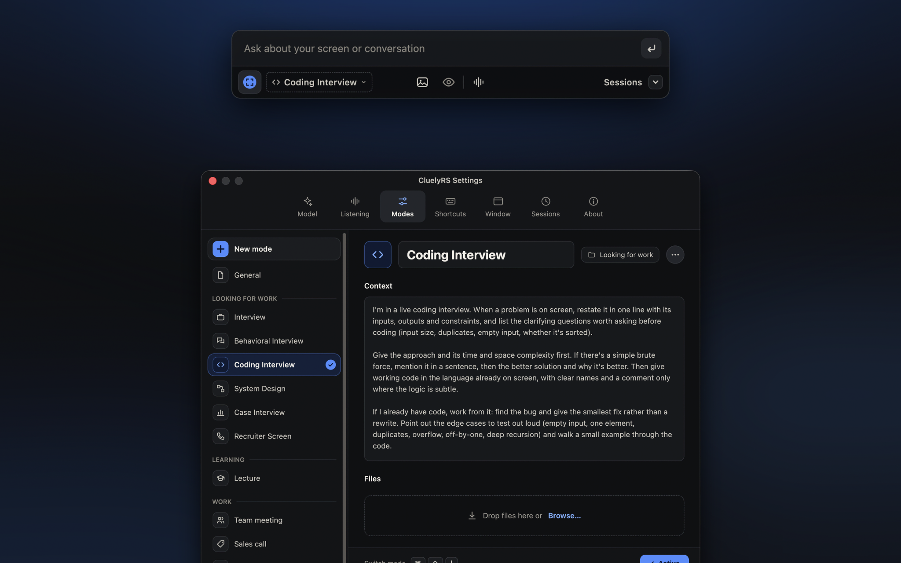
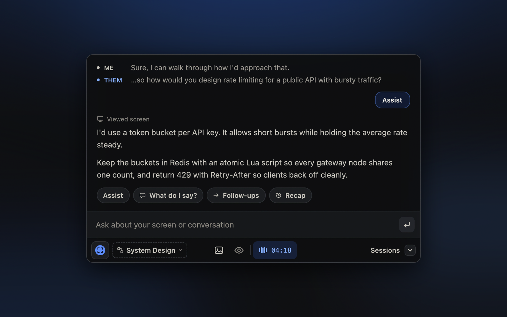
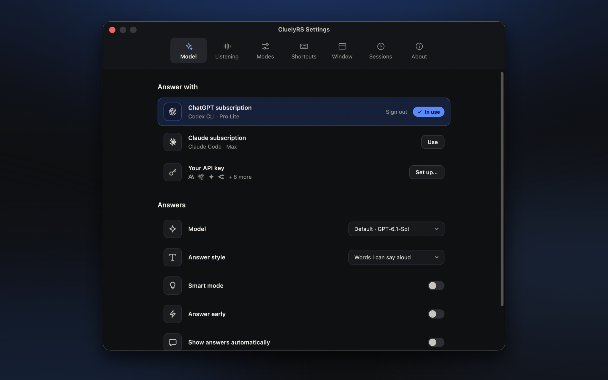
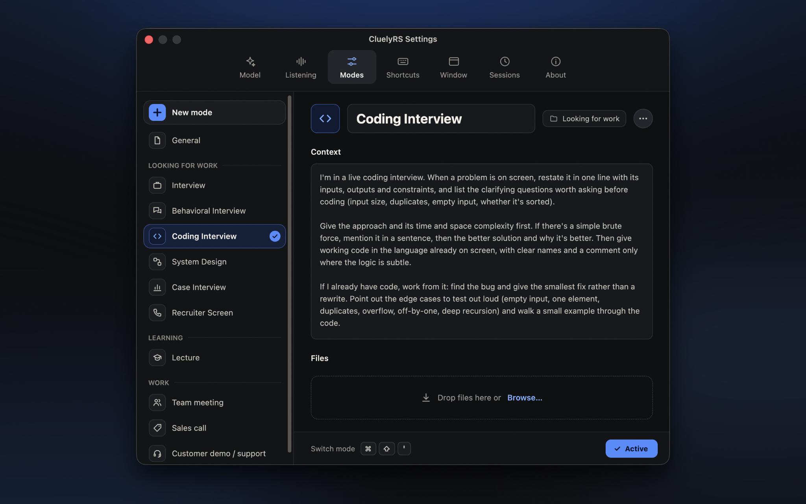

# cluely-rs

cluely without electron.

same idea. one native app. about 95% less ram at idle on my mac.

i wanted an ai overlay, not a bloated browser pretending to be one.

so i built one in rust + [gpui](https://gpui.rs). it sees your screen, listens, and answers with your chatgpt subscription, claude subscription, or your own api key.

no new subscription to me. and it stays undetected.



## what it does

- **native.** rust + gpui. not electron.
- **sees your screen.** fresh screenshot with every question.
- **hears both sides.** mic and desktop audio stay separate.
- **transcribes locally.** nvidia parakeet realtime on your machine. deepgram is an option too.
- **your models, not mine.** chatgpt, claude, or an api key.
- **keeps the receipts.** session transcripts, screenshots, answers, summaries, search.
- **undetected.** capture exclusion on supported systems, click-through overlay, and keyboard controls.



## there when you need it. out of sight when you don't.
- **hidden from supported captures.** the overlay can be excluded from supported screenshot and screen-sharing capture paths. windows uses `WDA_EXCLUDEFROMCAPTURE` on supported versions.
- **click-through.** most of the overlay doesn't intercept your mouse. the app underneath still works.
- **keyboard-first.** open it, ask, move it, scroll, hide it. no window juggling.
- **on your terms.** turn listening on when you want it, stop it when you're done.

capture exclusion depends on the os and capture method, and doesn't guarantee invisibility to every recorder, monitoring tool, or physical camera. macos behavior still needs platform-specific verification.


## benchmarks

measured against cluely 2.1.24.

| idle (average) | cluely | cluely-rs |
|---|---:|---:|
| memory | 515.9 MB | **26.1 MB** |
| cpu | **0.34%** | 0.75% |
| processes | 10 | **1** |

**26mb vs 516mb.** about **95% less idle memory**. **20x less** to sit there and do nothing.

cluely did use less idle cpu.

### transcription latency

| | median after speech ends |
|---|---:|
| cluely-rs, parakeet (local) | **540 ms** |
| cluely-rs, deepgram | 710 ms |
| cluely 2.1.24 | 830 ms |

**540ms local. 830ms cluely.** parakeet committed speech about **35% sooner** on this recording, without sending audio to a transcription service.

this measures speech-to-transcript delay, not time to an ai answer. parakeet made more recognition mistakes on the sample. numbers are numbers.

### answer speed

not every model is equally fast. that's why you get to choose.

some **warm** timings from the benchmark tool:

| setup | first text | full answer |
|---|---:|---:|
| claude code / opus 5.5 | **0.71 s** | 2.78 s |
| codex / gpt-6-luna | 1.38 s | **1.95 s** |
| api key / haiku 5.5 | 1.79 s | 2.47 s |
| cluely | 1.93 s | 3.30 s |

not calling these a head-to-head win. these were measured through the cluely-rs benchmark tool with a prepared screenshot, not the in-app hotkey. cluely was timed through its actual overlay, with an unknown model.

<details>

<summary>how i measured this</summary>

- apple m1 (8 cores), 8 gb ram, macos 26.3; cluely 2.1.24 free plan vs cluely-rs release build.
- idle cpu/memory averaged over 62 seconds (cluely) and 60 seconds (cluely-rs), counting the whole app process tree. mac cpu percentages are per core (100% = one busy core).
- transcription used the same 31-second recording of six interview questions; the comparison was a single run per app/provider, not a multi-day study.
- answer-time "warm" values are medians of three requests after one cold request per setup. they include screenshot request preparation and measure the benchmark tool, not in-app hotkey-to-text latency.
- excluded invalid early memory measurements that double-counted processes, polling-contaminated cpu readings, and estimated/halved meeting results. no windows comparison or answer-quality comparison was done.

</details>

## install

### windows

grab `CluelyRS-<version>-setup.exe` from [releases](https://github.com/jayamartinez/cluely-rs/releases) once one is up and run it. that's it. no wizard, no admin prompt. it installs for your account into `%LOCALAPPDATA%\Programs\CluelyRS` and opens cluely-rs when it's done.

needs windows 10 (version 2004+) on a 64-bit pc with avx2 (pretty much any intel or amd cpu from 2013 on). new versions install right over the old one. your settings, sessions, and keys stay.

the installer isn't code-signed, so windows will complain:

- **"windows protected your pc"** (smartscreen): click **more info**, then **run anyway**.
- **microsoft defender** might flag or remove it. hiding from screen capture + global shortcuts looks a lot like what malware does. restore it from windows security → virus & threat protection → protection history (**allow on device**), and add an exclusion for `%LOCALAPPDATA%\Programs\CluelyRS` if it keeps happening.

uninstall from settings → apps → installed apps. it asks if you also want your settings, sessions, speech models, and saved api keys gone. say no and they're kept for a reinstall.

### macos

grab `CluelyRS-<version>.dmg` from [releases](https://github.com/jayamartinez/cluely-rs/releases) once one is up. open it, drag **CluelyRS** onto **applications**, eject it, and open CluelyRS from your applications folder. run it from there, not from the dmg or downloads: macos runs apps from those from a temporary read-only copy, and that breaks **quit & reopen**.

needs an apple silicon mac (no intel build) on macos 13 ventura or later. want to check the download? run `shasum -a 256 -c CluelyRS-<version>.dmg.sha256` in the folder you saved both files to.

the app isn't notarized by apple (that takes a paid developer account), so the first open gets blocked: **"apple could not verify CluelyRS is free of malware"** (or **"can't be opened"** on older macos). click **done** (or **ok**), then open system settings → privacy & security, scroll down to security, click **open anyway** next to the message about CluelyRS, sign in with your password, and click **open anyway** again. once per download. on macos 13–14, control-click → **open** works too. sequoia (15) and later don't allow that anymore.

the first launch walks you through setup: welcome, permissions, model, transcription. it asks for two permissions:

- **microphone**: transcribes your side (**me**).
- **screen & system audio recording**: screenshots for your questions and desktop audio (**them**). macos only applies it after a restart, so setup offers **quit & reopen** and picks up where you left off.

change them later in system settings → privacy & security → microphone / screen & system audio recording.

cluely-rs lives in the menu bar, not the dock. turn on **show in dock** in settings if you want it there and in ⌘tab.

cluely-rs tells you when there's a new version. download the new dmg and drag it into applications, choosing **replace**. your settings, sessions, keys, and permissions stay. you might have to do the **open anyway** step again.

to uninstall, quit from the menu bar icon and drag `/Applications/CluelyRS.app` to the trash. that keeps your stuff for a reinstall. to remove it too, delete `~/Library/Application Support/CluelyRS` (settings, sessions, modes, speech models) and `~/Library/Logs/CluelyRS`, and the `CluelyRS` items in keychain access (saved api keys).

## build it yourself

windows 10 (version 2004+) or macos 13+ for the supported platform-specific features described below.

for windows builds you'll need:

- rust stable + msvc toolchain (vs 2022 build tools, including cmake and ninja)
- cmake 3.18+
- [git for windows](https://git-scm.com/download/win)

```powershell

git clone git@github.com:jayamartinez/cluely-rs.git

cd cluely-rs

git submodule update --init third_party/parakeet.cpp

git -C third_party/parakeet.cpp submodule update --init third_party/ggml

cargo run            # debug + console logs

cargo run --release  # no console window

```

yes, the two submodules are needed. if windows complains about long paths:

```powershell

git config --global core.longpaths true

```

on macos (apple silicon, 13+) you'll need rust stable, the xcode command line tools (`xcode-select --install`), and cmake. same commands, minus the long paths thing.

want to use a subscription instead of an api key? install and sign in to [codex cli](https://github.com/openai/codex) for chatgpt or [claude code](https://claude.com/claude-code) for claude.

## controls

it's keyboard-first. the whole point is not having to stop what you're doing.

| shortcut | what happens |
|---|---|
| `Ctrl Shift Space` | focus the text box; press again to return to your app without losing the draft. enter sends; esc returns without sending |
| `Ctrl ↵` | assist: answer using your current screen + conversation. starts live if needed |
| `Ctrl \\` | show/hide the overlay |
| `Ctrl Alt ←↑↓→` | move the overlay. hold to glide |
| `Ctrl Alt Shift ↑↓` | scroll the answer |
| `Esc` | close settings |

live turns on when you click the waveform, type something, use a quick action, or press assist. click the waveform again to stop it. there's no stop-live shortcut yet.

only the pill, quick actions, and text box accept clicks. the rest is click-through. movement/scroll shortcuts are grabbed only while the overlay is visible. `Ctrl ↵` is grabbed for as long as the app runs.



## pick your model

i don't think you should have to pay to use a model you're already paying for.

- **chatgpt subscription:** official codex app-server. tools, shell, mcp, and network disabled; read-only sandbox; empty working folder.
- **claude subscription:** official claude code cli, tools disabled.
- **api key:** anthropic, openai, openrouter, gemini, xai, groq, deepseek, mistral, together, ollama, lm studio, or any openai-compatible endpoint.

api keys go in windows credential manager or macos keychain not plaintext.

answers start short (1–3 sentences) and use the lightest reasoning available. waiting ten seconds for a two-word answer isn't a feature. **smart mode** is there when the question deserves more thought.

when live starts, the chatgpt provider warms its thread and claude starts its process, so your first assist doesn't have to pay all that startup cost.

## modes

make different modes for interviews, meetings, whatever. give each its own instructions and files. switch when you need to.



## listening

live transcribes **me** (mic) and **them** (desktop audio) separately using nvidia parakeet realtime. the panel shows the last two lines and what's being said right now. uncertain words appear muted/italic until the recognizer settles. a blue **?** means it probably heard a question.

parakeet downloads through settings on first use (~176mb, checksum verified). mic and desktop audio have separate toggles and device selectors.

on macos 13+, desktop capture uses screencapturekit. it's whatever your system is playing, listed as **system audio**. you'll need screen recording permission. if you don't grant it, the app tells you and mic capture can still work.

turn off **transcribe conversations** if you just want the overlay + screen questions.

prefer cloud transcription? add a deepgram key and choose nova-3 in settings. everything after speech recognition works the same, so you can compare the two using the latency report.

## sessions

sessions include transcripts, screenshots, answers, a timeline, search, ai summaries, and **ask about this session**.

retention is configurable: 7 days, 30 days, or forever.

### where your stuff lives

| | windows | macos |
|---|---|---|
| settings | `%APPDATA%\CluelyRS\settings.json` | `~/Library/Application Support/CluelyRS/settings.json` |
| sessions/screenshots | `%APPDATA%\CluelyRS\sessions\\` | `~/Library/Application Support/CluelyRS/sessions/` |
| keys | credential manager (`CluelyRS`) | login keychain (`CluelyRS`) |
| speech models | `%LOCALAPPDATA%\CluelyRS\models\\` | `~/Library/Application Support/CluelyRS/models/` |
| logs (errors + crash reports) | `%LOCALAPPDATA%\CluelyRS\logs\cluelyrs.log` | `~/Library/Logs/CluelyRS/cluelyrs.log` |

nothing gets uploaded except requests to whichever ai or transcription provider you chose.

## developing

```powershell

cargo test

cargo clippy --all-targets

# make fake sessions to test the history ui

.\dev\make-demo-sessions.ps1 -Out "$env:TEMP\cluelyrs-demo"

$env:CLUELYRS_DATA_DIR = "$env:TEMP\cluelyrs-demo"; cargo run

```

i benchmarked the pipeline instead of guessing why it felt slow.

**latency:** set `CLUELYRS_METRICS=1`. every live session dumps pipeline timings to JSONL under `%LOCALAPPDATA%\CluelyRS\metrics\\`, plus the captured `live-<time>-me.wav` and `-them.wav` (16khz mono).

```powershell

cargo run --example latency_report -- <file.jsonl>...

cargo run --example answer_latency -- [--warm] [--smart]

```

that second command makes one real provider request per run, using your selected key or subscription.

**transcription / endpointing:**

```powershell

cargo run --example parakeet_bench -- download

cargo run --example transcript_replay -- <wav>

cargo run --example endpoint_eval

```

`parakeet_bench` benchmarks speed, cpu, memory, latency, and long-run reliability. generate test speech with `dev/make-bench-audio.ps1`.

`transcript_replay` feeds a recording through the actual pipeline in real time and shows partial transcripts, final commits, and speech boundaries. because real audio breaks in ways clean demos never show.

`endpoint_eval` scores recorded captures plus the bench clip: fragments, merged questions, commit latency, and why each commit happened. it caches recognition and replays on the audio clock, so comparisons are deterministic and don't cost api money. `--config`, `--stall`, `--slow`, and `--lag` let you compare configs and simulate a recognizer falling behind.

see [patches.md](PATCHES.md) for third-party changes and build details.

need the overlay to show up in screenshots during development? `CLUELYRS_ALLOW_CAPTURE=1`.

live provider tests are ignored by default. run `cargo test -- --ignored` with the variables described in `claude_cli.rs` and `codex.rs`.

release builds write their errors and crash reports to the log file instead of a console. want that in a debug build? `CLUELYRS_LOG_FILE=1`.

### releasing (windows)

set `version` in `Cargo.toml`, then push a matching tag (`git tag v0.1.0 && git push origin v0.1.0`). the [release (windows)](.github/workflows/release-windows.yml) workflow builds the exe (static c runtime, so no visual c++ redistributable needed), generates `THIRD_PARTY_LICENSES.txt` with [cargo-about](https://github.com/EmbarkStudios/cargo-about), builds the [inno setup](https://jrsoftware.org/isinfo.php) installer, and attaches it to a draft release. publish the draft once the macos build is on it too. one `.exe` per release: the update check grabs the first one it finds.

same build locally, with inno setup 6.5+ and `cargo install cargo-about --locked --features cli`:

```powershell
cargo build --release
.\dev\third-party-licenses.ps1
.\dev\build-installer.ps1   # target\installer\CluelyRS-<version>-setup.exe
```

gpui's release build compiles shaders with `fxc.exe` from windows sdk 10.0.26100. on another sdk, point `GPUI_FXC_PATH` at its `fxc.exe` (e.g. `C:\Program Files (x86)\Windows Kits\10\bin\10.0.22621.0\x64\fxc.exe`).

### releasing (macos)

no workflow for this one yet. on an apple silicon mac, with python3 and `cargo install cargo-about --locked --features cli` for the license notices:

```sh
scripts/bundle-macos.sh   # dist/CluelyRS-<version>.dmg + .sha256
```

it builds the release, signs `CluelyRS.app` with the first **apple development** certificate in your login keychain (or `CLUELYRS_SIGN_IDENTITY`), and lays out the dmg with [dmgbuild](https://github.com/dmgbuild/dmgbuild), which it installs into a venv under `target/` on first use. a free apple development certificate is enough. with none it signs ad-hoc, and then every build looks like a new app to macos: permissions and keychain access reset. attach the `.dmg` and its `.sha256` to the draft release. one `.dmg` per release: the update check grabs the first one it finds.

## what's working

- native overlay, keybinds, click-through, screen-capture hiding
- model providers + fresh screenshots on send
- local live transcription for me/them, or deepgram if you want
- session history, saved transcripts, summaries
- answers that know what was said recently (last 10 minutes or 40 lines, plus what's being said now)
- persistent restricted codex thread during live sessions: only new context is sent each time
- new request cancels the old one. cancelled output doesn't leak into the overlay
- endpointing tested against real recordings, including when recognition falls behind on a busy cpu

## credits / licenses

- [parakeet.cpp](https://github.com/mudler/parakeet.cpp) (mit) + [ggml](https://github.com/ggml-org/ggml) (mit), pinned as submodules. see [PATCHES.md](PATCHES.md).

- [nvidia parakeet realtime eou 120m](https://huggingface.co/nvidia/parakeet_realtime_eou_120m-v1), nvidia open model license. downloaded at runtime, not shipped with the repo.

- icons from [lucide](https://lucide.dev) (isc) and provider logos from [simple icons](https://simpleicons.org) (cc0) and [lobe icons](https://github.com/lobehub/lobe-icons) (mit). the logos are their owners' trademarks, shown only to name the services cluely-rs connects to.

- the windows installer and the macos app ship `THIRD_PARTY_LICENSES.txt` with every rust crate's license plus the above.

cluely-rs itself is [mit licensed](LICENSE).
